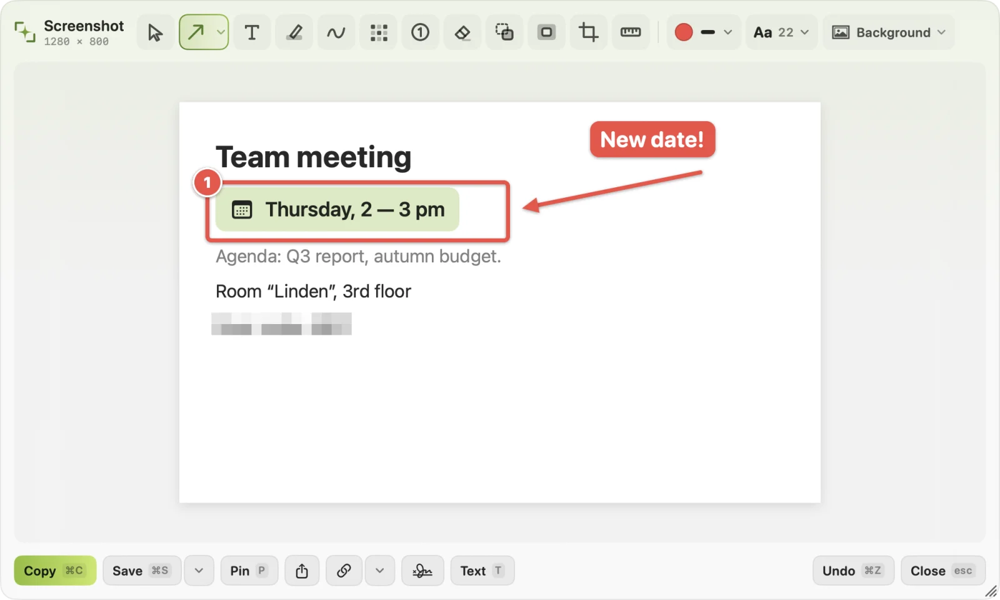
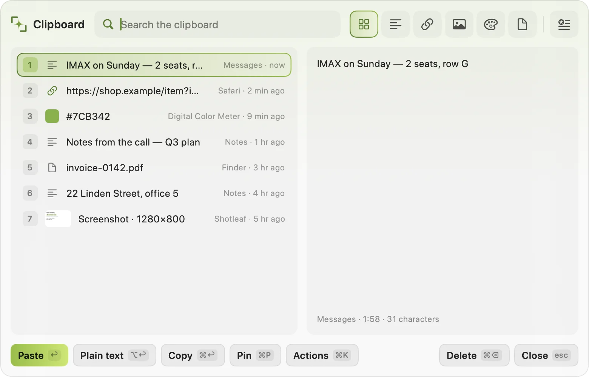
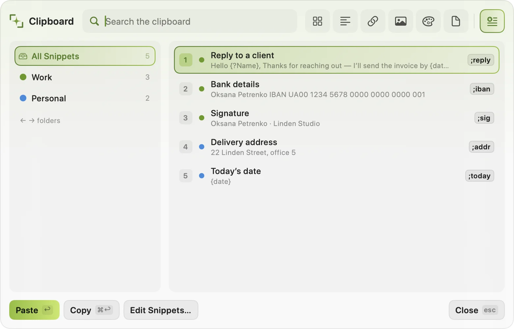

# Shotleaf

**English** · [Українська ↓](#українська)

Screenshots and clipboard history for the Mac. Shotleaf lives in the menu bar:

- **Screenshots** of an area, a window or the whole screen, with an editor for arrows, text, blur, backgrounds and watermarks.
- **Scrolling screenshots**: a whole page in one image.
- **Text from the screen**: copy words from any image or app, recognised on your Mac.
- **Clipboard history** with search, pinned items and screenshots; paste several items at once.
- **Snippets**: type an abbreviation anywhere and it expands, with dates, questions and pictures.
- **Text completion** as you type, from a small model that runs on your Mac.

<p align="center"></p>

<table><tr>
<td></td>
<td></td>
</tr><tr>
<td align="center">Clipboard history</td>
<td align="center">Snippets</td>
</tr></table>

Website: [shotleaf.syvyj.dev](https://shotleaf.syvyj.dev) · [Guide](https://shotleaf.syvyj.dev/guide/) · [Download](https://github.com/Syvyj/shotleaf/releases/latest/download/Shotleaf.dmg)

## Requirements

macOS 15 or later on Apple silicon (M1 or newer).

## Install

1. Download `Shotleaf.dmg` from [Releases](https://github.com/Syvyj/shotleaf/releases/latest), open it and drag **Shotleaf** onto **Applications**.
2. Open it. Shotleaf isn't notarised by Apple, so the first time macOS says it can't check the app. Open **System Settings › Privacy & Security**, scroll down and click **Open Anyway**.
3. The setup guide asks for two permissions:
   - **Screen Recording**: screenshots and text from the screen.
   - **Accessibility**: text completion, snippets and pasting from the clipboard history.

   Shotleaf restarts by itself after each one is turned on. Until both are on, the setup guide opens at every launch.
4. Text completion needs its model, Gemma 4 E2B (about 3.6 GB). Download it from the setup guide or **Settings › Completion**. Everything else works without it.

### After an update

macOS may stop trusting the new copy with its permissions even though the switches still look on. If screenshots or pasting stop working, open **System Settings › Privacy & Security**, remove Shotleaf with **–** from **Screen Recording** and **Accessibility**, and allow it again.

## Shortcuts

| | |
|---|---|
| Screenshot | ⌘⇧2 |
| Scrolling screenshot | ⌘⇧3 |
| Text from the screen | ⌘⇧1 |
| Clipboard history | ⇧⌘V |
| Snippets | ⇧⌘B |
| Edit the last screenshot | ⌃⌥⌘E |
| Edit an image from the clipboard | ⌃⌥⌘V |

⌘⇧3 is also the macOS full-screen screenshot, and some apps use ⇧⌘V or ⇧⌘B. Change any of them in **Settings › Shortcuts**.

A shortcut doesn't fire? Another app may be using it. If your keyboard goes through a keyboard-sharing app (Deskflow, Synergy, Barrier), it sends symbols rather than keys, so shortcuts with digits can depend on the keyboard layout on each computer; a shortcut with a letter works in any layout.

## Privacy

Shotleaf has no account and sends nothing anywhere. Text recognition and completion run on your Mac. The only network requests are the model download from Hugging Face (when you ask for it), the check for a new version (at launch and once a day Shotleaf asks GitHub which release is the newest; nothing about you is sent, and it can be turned off in **Settings › General**) and screenshot links: when you press the link button, the picture goes to Shotleaf's link service on Cloudflare (`s.syvyj.dev`, code in `server/links`) and is deleted when the link expires, 12 hours at most. You can use your own server instead (`server/shots`).

Passwords copied from password managers aren't kept in the history.

## Where your data lives

| | |
|---|---|
| Clipboard history, snippets, recent screenshots, writing style | `~/Library/Application Support/Shotleaf` |
| Settings | `~/Library/Preferences/dev.syvyj.shotleaf.plist` |
| Completion model | `~/.cache/huggingface/hub/models--mlx-community--gemma-4-e2b-4bit` |
| Saved screenshots | the folder chosen in Settings (Desktop by default) |

### Uninstall

Quit Shotleaf, then delete the app and the folders above:

```bash
rm -rf /Applications/Shotleaf.app ~/Library/Application\ Support/Shotleaf ~/.cache/huggingface/hub/models--mlx-community--gemma-4-e2b-4bit
defaults delete dev.syvyj.shotleaf
```

## Reporting a problem

Open an [issue](https://github.com/Syvyj/shotleaf/issues) or write to shotleaf@syvyj.dev. If Shotleaf crashed, attach the newest `Shotleaf-*.ips` file from `~/Library/Logs/DiagnosticReports`.

## Building from source

Needs Xcode 26 or later.

```bash
scripts/make-signing-cert.sh   # once: a local certificate, so permissions survive rebuilds
scripts/run.sh                 # build, install to ~/Applications and start
```

Tests: `cd ShotleafKit && swift test`.

The code is in the `ShotleafKit` Swift package (`Core`, `CaptureKit`, `PerceptionKit`, `SettingsKit`, `EmbeddedKit`, `AppFeature`); `App/` is the thin app target. Design decisions are in `ARCHITECTURE_DECISIONS.md`.

## Support

If Shotleaf saves you time, you can [support the author](https://shotleaf.syvyj.dev/#support).

## Licence

[GPL-3.0-or-later](LICENSE). © 2026 Oleksii Ziuzin (Syvyj). Third-party components and their licences: `ShotleafKit/Sources/AppFeature/Resources/ThirdPartyNotices.txt`.

---

# Українська

[↑ English](#shotleaf)

Скріншоти та історія буфера обміну для Mac. Shotleaf живе в рядку меню:

- **Скріншоти** області, вікна чи всього екрана, з редактором для стрілок, тексту, розмиття, фонів і водяних знаків.
- **Довгі скріншоти**: уся сторінка однією картинкою.
- **Текст зі скріншоту**: копіюйте слова з будь-якої картинки чи програми, розпізнаються на вашому Mac.
- **Історія буфера обміну** з пошуком, закріпленими записами й скріншотами; вставляйте кілька записів разом.
- **Сніпети**: наберіть скорочення будь-де, і воно розгорнеться, з датами, запитаннями й картинками.
- **Дописування тексту** під час набору, від невеликої моделі, що працює на вашому Mac.

<p align="center"></p>

<table><tr>
<td></td>
<td></td>
</tr><tr>
<td align="center">Історія буфера обміну</td>
<td align="center">Сніпети</td>
</tr></table>

Сайт: [shotleaf.syvyj.dev](https://shotleaf.syvyj.dev/uk/) · [Посібник](https://shotleaf.syvyj.dev/uk/guide/) · [Завантажити](https://github.com/Syvyj/shotleaf/releases/latest/download/Shotleaf.dmg)

## Вимоги

macOS 15 або новіша на Apple silicon (M1 чи новіший).

## Встановлення

1. Завантажте `Shotleaf.dmg` з [Releases](https://github.com/Syvyj/shotleaf/releases/latest), відкрийте його й перетягніть **Shotleaf** на **Програми**.
2. Відкрийте Shotleaf. Він поки не нотаризований Apple, тож першого разу macOS скаже, що не може перевірити програму. Відкрийте **Системні параметри › Приватність і безпека**, прогорніть униз і натисніть **Усе одно відкрити**.
3. Посібник із налаштування попросить два дозволи:
   - **Запис екрана**: скріншоти й розпізнавання тексту.
   - **Універсальний доступ**: дописування тексту, сніпети й вставка з історії буфера.

   Після кожного дозволу Shotleaf перезапускається сам. Поки обидва не ввімкнені, посібник відкривається при кожному запуску.
4. Для дописування тексту потрібна модель Gemma 4 E2B (близько 3,6 ГБ). Завантажте її з посібника або в **Налаштуваннях › Дописування**. Усе інше працює без неї.

### Після оновлення

macOS може перестати довіряти новій версії дозволи, хоча перемикачі виглядають увімкненими. Якщо скріншоти чи вставка перестали працювати, відкрийте **Системні параметри › Приватність і безпека**, приберіть Shotleaf кнопкою **–** із **Запису екрана** й **Універсального доступу** та дозвольте знову.

## Гарячі клавіші

| | |
|---|---|
| Скріншот | ⌘⇧2 |
| Довгий скріншот | ⌘⇧3 |
| Текст зі скріншоту | ⌘⇧1 |
| Історія буфера | ⇧⌘V |
| Сніпети | ⇧⌘B |
| Редагувати останній знімок | ⌃⌥⌘E |
| Редагувати картинку з буфера | ⌃⌥⌘V |

⌘⇧3 у macOS ще й знімок усього екрана, а деякі програми використовують ⇧⌘V чи ⇧⌘B. Будь-яку клавішу можна змінити в **Налаштуваннях › Гарячі клавіші**.

Клавіша не спрацьовує? Можливо, її зайняла інша програма. Якщо клавіатура працює через програму для спільної клавіатури (Deskflow, Synergy, Barrier), вона передає символи, а не клавіші, тож комбінації з цифрами можуть залежати від розкладки на кожному комп'ютері; комбінація з літерою працює в будь-якій розкладці.

## Приватність

У Shotleaf немає облікового запису, і він нічого нікуди не надсилає. Розпізнавання тексту й дописування працюють на вашому Mac. Єдині запити в мережу: завантаження моделі з Hugging Face (коли ви про це попросите), перевірка нової версії (під час запуску й раз на день Shotleaf питає в GitHub, який реліз найновіший; нічого про вас не надсилається, а вимкнути її можна в **Налаштуваннях › Загальні**) і посилання на скріншоти. Коли ви натискаєте кнопку посилання, картинка йде в сервіс посилань Shotleaf на Cloudflare (`s.syvyj.dev`, код у `server/links`) і видаляється, коли посилання спливає, щонайбільше за 12 годин. Замість нього можна підключити власний сервер (`server/shots`).

Паролі, скопійовані з менеджерів паролів, в історії не зберігаються.

## Де лежать ваші дані

| | |
|---|---|
| Історія буфера, сніпети, останні скріншоти, стиль письма | `~/Library/Application Support/Shotleaf` |
| Налаштування | `~/Library/Preferences/dev.syvyj.shotleaf.plist` |
| Модель дописування | `~/.cache/huggingface/hub/models--mlx-community--gemma-4-e2b-4bit` |
| Збережені скріншоти | тека з Налаштувань (спершу Робочий стіл) |

### Видалення

Закрийте Shotleaf, потім видаліть програму й теки вище:

```bash
rm -rf /Applications/Shotleaf.app ~/Library/Application\ Support/Shotleaf ~/.cache/huggingface/hub/models--mlx-community--gemma-4-e2b-4bit
defaults delete dev.syvyj.shotleaf
```

## Якщо щось не так

Створіть [issue](https://github.com/Syvyj/shotleaf/issues) або напишіть на shotleaf@syvyj.dev. Якщо Shotleaf упав, додайте найновіший файл `Shotleaf-*.ips` з `~/Library/Logs/DiagnosticReports`.

## Збірка з коду

Потрібен Xcode 26 або новіший.

```bash
scripts/make-signing-cert.sh   # один раз: локальний сертифікат, щоб дозволи переживали перезбірку
scripts/run.sh                 # зібрати, встановити в ~/Applications і запустити
```

Тести: `cd ShotleafKit && swift test`.

Код у Swift-пакеті `ShotleafKit` (`Core`, `CaptureKit`, `PerceptionKit`, `SettingsKit`, `EmbeddedKit`, `AppFeature`); `App/` лише тонка обгортка застосунку. Рішення щодо архітектури в `ARCHITECTURE_DECISIONS.md`.

## Підтримка

Якщо Shotleaf заощаджує вам час, можете [підтримати автора](https://shotleaf.syvyj.dev/uk/#support).

## Ліцензія

[GPL-3.0-or-later](LICENSE). © 2026 Oleksii Ziuzin (Syvyj). Сторонні компоненти та їхні ліцензії: `ShotleafKit/Sources/AppFeature/Resources/ThirdPartyNotices.txt`.
