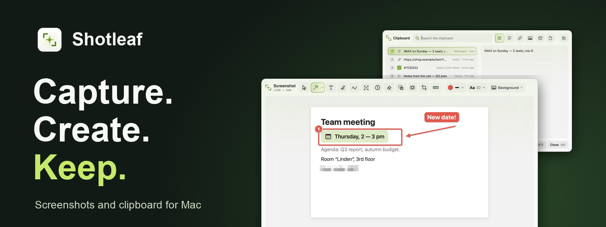
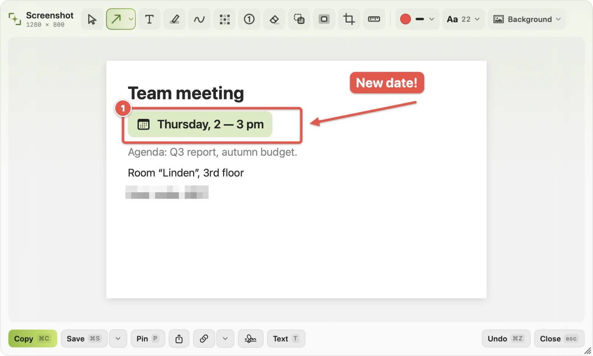
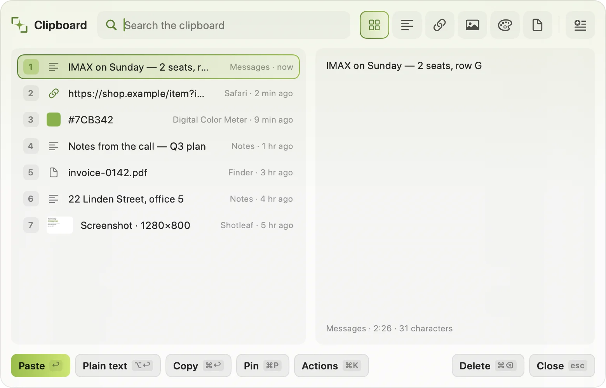
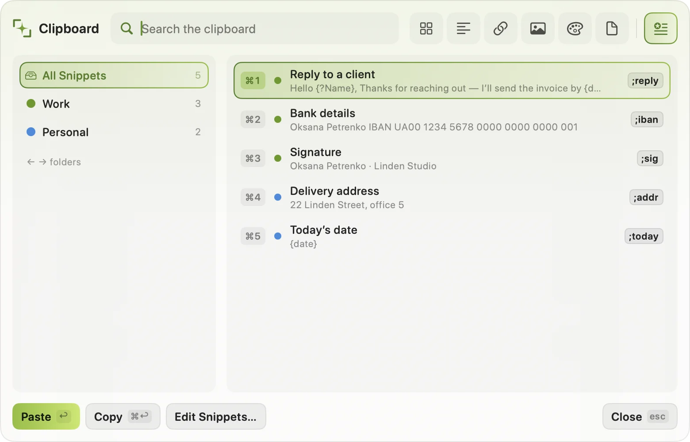
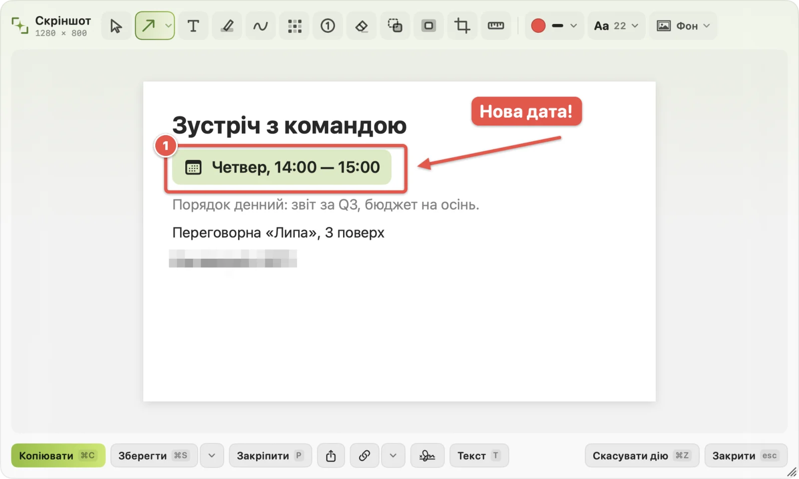
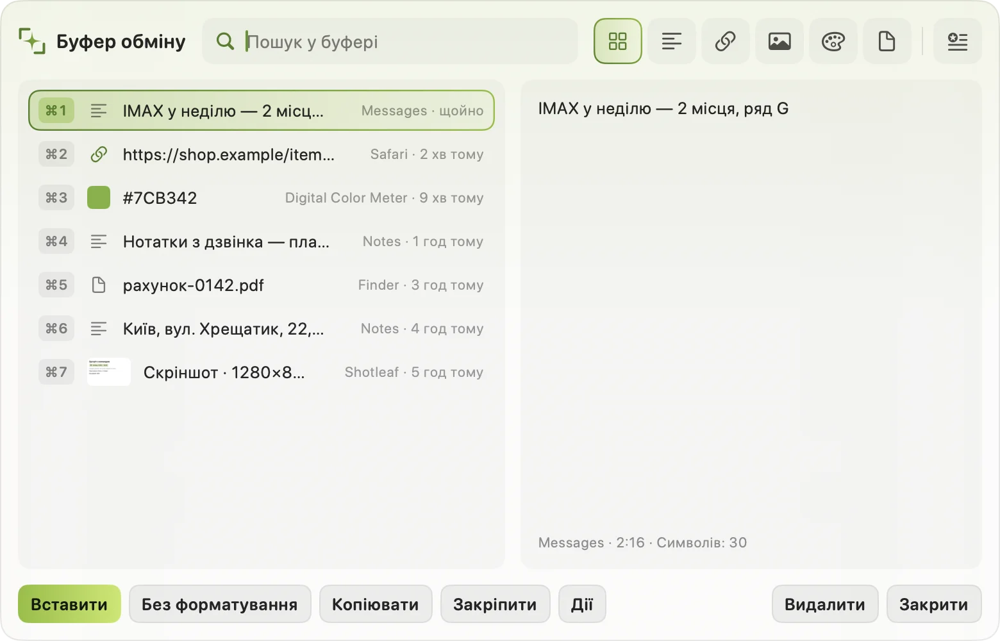
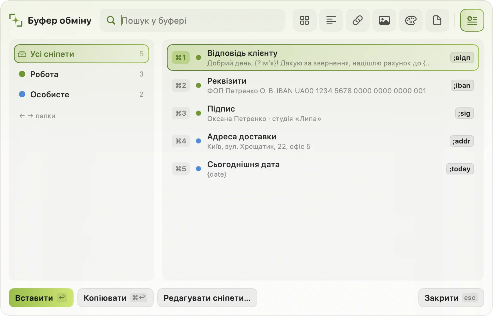

<a name="en"></a>



**English** · [Українська ↓](#uk)

# Shotleaf

Capture and annotate screenshots, find what you copied, and bring frequently used text back in a few keystrokes. Shotleaf lives in your Mac menu bar. Free and open source, with no account or tracking.

**[Download for Mac](https://github.com/Syvyj/shotleaf/releases/latest/download/Shotleaf.dmg)** · [Website](https://shotleaf.syvyj.dev) · [Guide](https://shotleaf.syvyj.dev/guide/) · [Releases](https://github.com/Syvyj/shotleaf/releases)

macOS 15+ · Apple silicon (M1 or newer) · [GPL-3.0-or-later](LICENSE) · [](https://github.com/Syvyj/shotleaf/actions/workflows/ci.yml)

## 01 · Capture and annotate

Capture an area, a window, the screen or a scrolling page. Add arrows, text, shapes, backgrounds and watermarks; blur private information and copy text from images on your Mac.



## 02 · Find what you copied

Search and pin items in clipboard history, find screenshots and paste several items at once.



## 03 · Let snippets do the typing

Expand abbreviations into reusable text with dates, questions and pictures. Optional text completion runs from a model on your Mac.



## Requirements

macOS 15 or later on Apple silicon (M1 or newer).

## Install

1. Download `Shotleaf.dmg` from [Releases](https://github.com/Syvyj/shotleaf/releases/latest), open it and drag **Shotleaf** onto **Applications**.
2. Open it. Shotleaf isn't notarised by Apple, so the first time macOS says it can't check the app. Open **System Settings › Privacy & Security**, scroll down and click **Open Anyway**.
3. The setup guide asks for two permissions:
   - **Screen Recording**: screenshots and text from the screen.
   - **Accessibility**: text completion, snippets and pasting from the clipboard history.

   Shotleaf restarts by itself after each one is turned on. Until both are on, the setup guide opens at every launch.
4. Text completion needs its model, Gemma 4 E2B (about 3.6 GB). Download it from the setup guide or **Settings › Completion**. Everything else works without it.

### Updates

When a new version is out, **Update to Shotleaf…** appears at the top of the menu. Shotleaf downloads it, checks that the release is signed with Shotleaf's update key, that the download matches it and that the app inside is signed like the one you have, and restarts into it, with your settings and permissions. It looks for a new version at launch and once a day (turn that off in **Settings › General**). Versions before 0.1.3 can't do this yet: update those once by hand from [Releases](https://github.com/Syvyj/shotleaf/releases/latest), quitting Shotleaf first.

### After an update

macOS may stop trusting the new copy with its permissions even though the switches still look on. If screenshots or pasting stop working, open **System Settings › Privacy & Security**, remove Shotleaf with **–** from **Screen Recording** and **Accessibility**, and allow it again.

## Shortcuts

| | |
|---|---|
| Screenshot | ⌘⇧2 |
| Scrolling screenshot | ⌘⇧3 |
| Text from the screen | ⌘⇧1 |
| Clipboard history | ⇧⌘V |
| Snippets | ⇧⌘B |
| Edit the last screenshot | ⌃⌥⌘E |
| Edit an image from the clipboard | ⌃⌥⌘V |

⌘⇧3 is also the macOS full-screen screenshot, and some apps use ⇧⌘V or ⇧⌘B. Change any of them in **Settings › Shortcuts**.

A shortcut doesn't fire? Another app may be using it. If your keyboard goes through a keyboard-sharing app (Deskflow, Synergy, Barrier), it sends symbols rather than keys, so shortcuts with digits can depend on the keyboard layout on each computer; a shortcut with a letter works in any layout.

## Privacy

Shotleaf has no account and no analytics. Text recognition, blurring private info and completion run on your Mac. It goes online for three things only:

- **The completion model**, downloaded once from Hugging Face when you ask for it. After that it loads from disk.
- **The check for a new version**: at launch and once a day Shotleaf asks GitHub which release is the newest. Nothing about you is sent. Turn it off in **Settings › General**.
- **Screenshot links**, when you press the link button: the picture goes to Shotleaf's link service on Cloudflare (`s.syvyj.dev`, code in `server/links`) and is deleted when the link expires (within 15 minutes of it), 12 hours at most. A picture over 5 MB goes as a JPEG that fits. You can use your own server instead (`server/shots`). **Check** in Settings › Screenshot Links sends a 1-pixel picture the same way.

Passwords copied from password managers aren't kept in the history. Card numbers and access tokens stay in memory for a minute and never reach the disk, unless you pin them. Learning your writing style is off until you turn it on.

## Where your data lives

| | |
|---|---|
| Clipboard history, snippets, recent screenshots, writing style | `~/Library/Application Support/Shotleaf` |
| Settings | `~/Library/Preferences/dev.syvyj.shotleaf.plist` |
| Completion model | `~/.cache/huggingface/hub/models--mlx-community--gemma-4-e2b-4bit` |
| Saved screenshots | the folder chosen in Settings (Desktop by default) |

### Uninstall

Quit Shotleaf, then delete the app and the folders above:

```bash
rm -rf /Applications/Shotleaf.app ~/Library/Application\ Support/Shotleaf ~/.cache/huggingface/hub/models--mlx-community--gemma-4-e2b-4bit
defaults delete dev.syvyj.shotleaf
```

## Reporting a problem

Open an [issue](https://github.com/Syvyj/shotleaf/issues) or write to shotleaf@syvyj.dev. If Shotleaf crashed, attach the newest `Shotleaf-*.ips` file from `~/Library/Logs/DiagnosticReports`.

## Building from source

Needs Xcode 26 or later.

```bash
scripts/make-signing-cert.sh   # once: a local certificate, so permissions survive rebuilds
scripts/run.sh                 # build, install to ~/Applications and start
```

Tests: `cd ShotleafKit && swift test`.

The code is in the `ShotleafKit` Swift package (`Core`, `CaptureKit`, `PerceptionKit`, `SettingsKit`, `EmbeddedKit`, `AppFeature`); `App/` is the thin app target. Design decisions are in `ARCHITECTURE_DECISIONS.md`.

## Questions, bugs, ideas

Bugs and ideas go to [Issues](https://github.com/Syvyj/shotleaf/issues/new/choose) (**Report a Problem…** in the menu fills in the versions); questions to [Discussions](https://github.com/Syvyj/shotleaf/discussions).

## Support

Donations support my time on Shotleaf and my other apps: [support the author](https://shotleaf.syvyj.dev/#support).

## Licence

[GPL-3.0-or-later](LICENSE). © 2026 Oleksii Ziuzin (Syvyj). Third-party components and their licences: `ShotleafKit/Sources/AppFeature/Resources/ThirdPartyNotices.txt`.

---

<a name="uk"></a>


[↑ English](#en) · **Українська**

# Shotleaf

Робіть і редагуйте скріншоти, знаходьте скопійоване й повертайте потрібний текст кількома натисканнями. Shotleaf живе в рядку меню Mac. Безкоштовний і з відкритим кодом, без акаунта й стеження.

**[Завантажити для Mac](https://github.com/Syvyj/shotleaf/releases/latest/download/Shotleaf.dmg)** · [Сайт](https://shotleaf.syvyj.dev/uk/) · [Посібник](https://shotleaf.syvyj.dev/uk/guide/) · [Релізи](https://github.com/Syvyj/shotleaf/releases)

macOS 15+ · Apple silicon (M1 або новіший) · [GPL-3.0-or-later](LICENSE)

## 01 · Знімайте й редагуйте

Знімайте область, вікно, екран або довгу сторінку. Додавайте стрілки, текст, фігури, фони й водяні знаки; розмивайте приватні дані та копіюйте текст із зображень на Mac.



## 02 · Знаходьте скопійоване

Шукайте й закріплюйте записи в історії буфера, знаходьте скріншоти та вставляйте кілька записів разом.



## 03 · Доручіть повторення сніпетам

Розгортайте скорочення в готовий текст із датами, запитаннями й картинками. Необов'язкове дописування тексту працює за допомогою моделі на вашому Mac.



## Вимоги

macOS 15 або новіша на Apple silicon (M1 чи новіший).

## Встановлення

1. Завантажте `Shotleaf.dmg` з [Releases](https://github.com/Syvyj/shotleaf/releases/latest), відкрийте його й перетягніть **Shotleaf** на **Програми**.
2. Відкрийте Shotleaf. Він поки не нотаризований Apple, тож першого разу macOS скаже, що не може перевірити програму. Відкрийте **Системні параметри › Приватність і безпека**, прогорніть униз і натисніть **Усе одно відкрити**.
3. Посібник із налаштування попросить два дозволи:
   - **Запис екрана**: скріншоти й розпізнавання тексту.
   - **Універсальний доступ**: дописування тексту, сніпети й вставка з історії буфера.

   Після кожного дозволу Shotleaf перезапускається сам. Поки обидва не ввімкнені, посібник відкривається при кожному запуску.
4. Для дописування тексту потрібна модель Gemma 4 E2B (близько 3,6 ГБ). Завантажте її з посібника або в **Налаштуваннях › Дописування**. Усе інше працює без неї.

### Оновлення

Коли виходить нова версія, угорі меню з’являється **Оновити до Shotleaf…**. Shotleaf завантажує її, перевіряє, що реліз підписаний ключем оновлень Shotleaf, що завантаження йому відповідає і що застосунок усередині підписаний так само, як ваш, і перезапускається вже в ній, з усіма налаштуваннями й дозволами. Нову версію він шукає під час запуску й раз на день (вимкнути можна в **Налаштуваннях › Загальні**). Версії до 0.1.3 так ще не вміють: їх один раз оновіть вручну з [Releases](https://github.com/Syvyj/shotleaf/releases/latest), спершу закривши Shotleaf.

### Після оновлення

macOS може перестати довіряти новій версії дозволи, хоча перемикачі виглядають увімкненими. Якщо скріншоти чи вставка перестали працювати, відкрийте **Системні параметри › Приватність і безпека**, приберіть Shotleaf кнопкою **–** із **Запису екрана** й **Універсального доступу** та дозвольте знову.

## Гарячі клавіші

| | |
|---|---|
| Скріншот | ⌘⇧2 |
| Довгий скріншот | ⌘⇧3 |
| Текст зі скріншоту | ⌘⇧1 |
| Історія буфера | ⇧⌘V |
| Сніпети | ⇧⌘B |
| Редагувати останній знімок | ⌃⌥⌘E |
| Редагувати картинку з буфера | ⌃⌥⌘V |

⌘⇧3 у macOS ще й знімок усього екрана, а деякі програми використовують ⇧⌘V чи ⇧⌘B. Будь-яку клавішу можна змінити в **Налаштуваннях › Гарячі клавіші**.

Клавіша не спрацьовує? Можливо, її зайняла інша програма. Якщо клавіатура працює через програму для спільної клавіатури (Deskflow, Synergy, Barrier), вона передає символи, а не клавіші, тож комбінації з цифрами можуть залежати від розкладки на кожному комп'ютері; комбінація з літерою працює в будь-якій розкладці.

## Приватність

У Shotleaf немає облікового запису й аналітики. Розпізнавання тексту, розмиття приватного й дописування працюють на вашому Mac. У мережу він ходить лише по три речі:

- **Модель для дописування**: завантажується один раз із Hugging Face, коли ви про це попросите. Далі вона береться з диска.
- **Перевірка нової версії**: під час запуску й раз на день Shotleaf питає в GitHub, який реліз найновіший. Нічого про вас не надсилається. Вимкнути можна в **Налаштуваннях › Загальні**.
- **Посилання на скріншоти**, коли ви натискаєте кнопку посилання: картинка йде в сервіс посилань Shotleaf на Cloudflare (`s.syvyj.dev`, код у `server/links`) і видаляється, коли посилання спливає (протягом 15 хвилин після цього), щонайбільше за 12 годин. Картинка понад 5 МБ іде як JPEG, що вміщується в ліміт. Замість нього можна підключити власний сервер (`server/shots`). Кнопка **Перевірити** в Налаштуваннях › Посилання на скріншоти так само надсилає картинку в 1 піксель.

Паролі, скопійовані з менеджерів паролів, в історії не зберігаються. Номери карток і токени доступу живуть у пам'яті хвилину й не потрапляють на диск, якщо ви їх не закріпите. Навчання вашому стилю письма вимкнене, доки ви його не ввімкнете.

## Де лежать ваші дані

| | |
|---|---|
| Історія буфера, сніпети, останні скріншоти, стиль письма | `~/Library/Application Support/Shotleaf` |
| Налаштування | `~/Library/Preferences/dev.syvyj.shotleaf.plist` |
| Модель дописування | `~/.cache/huggingface/hub/models--mlx-community--gemma-4-e2b-4bit` |
| Збережені скріншоти | тека з Налаштувань (спершу Робочий стіл) |

### Видалення

Закрийте Shotleaf, потім видаліть програму й теки вище:

```bash
rm -rf /Applications/Shotleaf.app ~/Library/Application\ Support/Shotleaf ~/.cache/huggingface/hub/models--mlx-community--gemma-4-e2b-4bit
defaults delete dev.syvyj.shotleaf
```

## Якщо щось не так

Створіть [issue](https://github.com/Syvyj/shotleaf/issues) або напишіть на shotleaf@syvyj.dev. Якщо Shotleaf упав, додайте найновіший файл `Shotleaf-*.ips` з `~/Library/Logs/DiagnosticReports`.

## Збірка з коду

Потрібен Xcode 26 або новіший.

```bash
scripts/make-signing-cert.sh   # один раз: локальний сертифікат, щоб дозволи переживали перезбірку
scripts/run.sh                 # зібрати, встановити в ~/Applications і запустити
```

Тести: `cd ShotleafKit && swift test`.

Код у Swift-пакеті `ShotleafKit` (`Core`, `CaptureKit`, `PerceptionKit`, `SettingsKit`, `EmbeddedKit`, `AppFeature`); `App/` лише тонка обгортка застосунку. Рішення щодо архітектури в `ARCHITECTURE_DECISIONS.md`.

## Питання, помилки, ідеї

Помилки та ідеї — в [Issues](https://github.com/Syvyj/shotleaf/issues/new/choose) («Повідомити про проблему…» в меню сам підставить версії), питання — у [Discussions](https://github.com/Syvyj/shotleaf/discussions).

## Підтримка

Донати підтримують мою роботу над Shotleaf та іншими застосунками: [підтримати автора](https://shotleaf.syvyj.dev/uk/#support).

## Ліцензія

[GPL-3.0-or-later](LICENSE). © 2026 Oleksii Ziuzin (Syvyj). Сторонні компоненти та їхні ліцензії: `ShotleafKit/Sources/AppFeature/Resources/ThirdPartyNotices.txt`.
