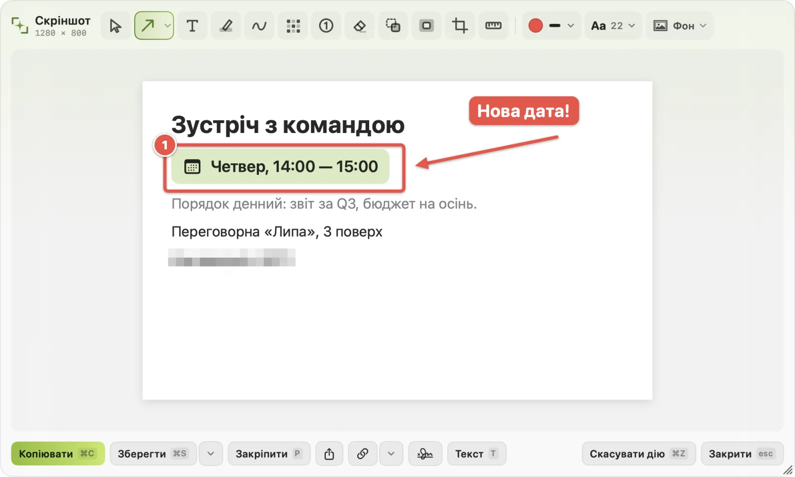
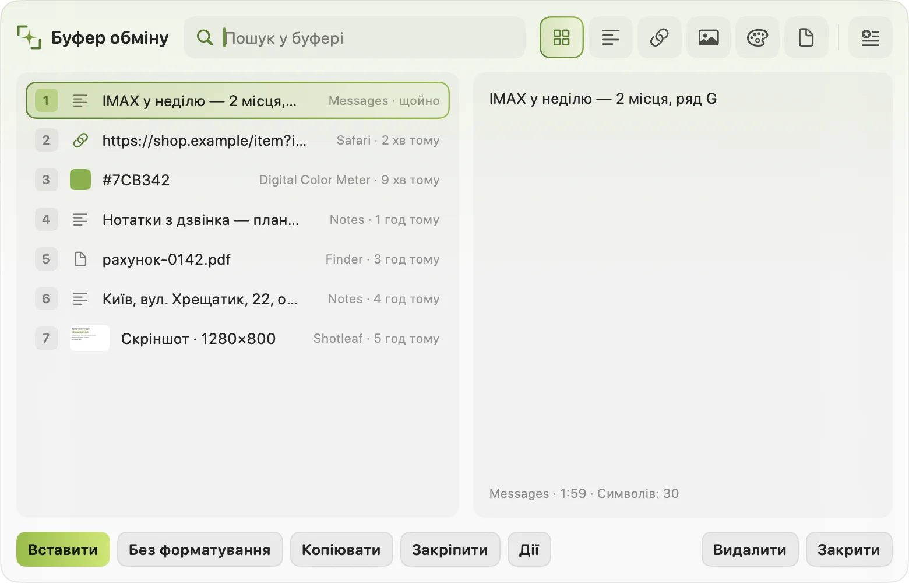
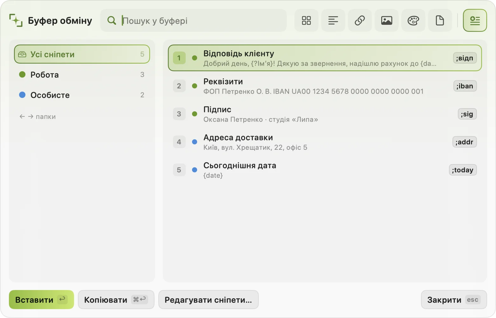

# Shotleaf

[English](README.md) · **Українська**

Скріншоти та історія буфера обміну для Mac. Shotleaf живе в рядку меню:

- **Скріншоти** області, вікна чи всього екрана, з редактором для стрілок, тексту, розмиття, фонів і водяних знаків.
- **Довгі скріншоти**: уся сторінка однією картинкою.
- **Текст зі скріншоту**: копіюйте слова з будь-якої картинки чи програми, розпізнаються на вашому Mac.
- **Історія буфера обміну** з пошуком, закріпленими записами й скріншотами; вставляйте кілька записів разом.
- **Сніпети**: наберіть скорочення будь-де, і воно розгорнеться, з датами, запитаннями й картинками.
- **Дописування тексту** під час набору, від невеликої моделі, що працює на вашому Mac.

<p align="center"></p>

<table><tr>
<td></td>
<td></td>
</tr><tr>
<td align="center">Історія буфера обміну</td>
<td align="center">Сніпети</td>
</tr></table>

Сайт: [shotleaf.syvyj.dev](https://shotleaf.syvyj.dev/uk/) · [Посібник](https://shotleaf.syvyj.dev/uk/guide/) · [Завантажити](https://github.com/Syvyj/shotleaf/releases/latest/download/Shotleaf.dmg)

## Вимоги

macOS 15 або новіша на Apple silicon (M1 чи новіший).

## Встановлення

1. Завантажте `Shotleaf.dmg` з [Releases](https://github.com/Syvyj/shotleaf/releases/latest), відкрийте його й перетягніть **Shotleaf** на **Програми**.
2. Відкрийте Shotleaf. Він поки не нотаризований Apple, тож першого разу macOS скаже, що не може перевірити програму. Відкрийте **Системні параметри › Приватність і безпека**, прогорніть униз і натисніть **Усе одно відкрити**.
3. Посібник із налаштування попросить два дозволи:
   - **Запис екрана**: скріншоти й розпізнавання тексту.
   - **Універсальний доступ**: дописування тексту, сніпети й вставка з історії буфера.

   Після кожного дозволу Shotleaf перезапускається сам. Поки обидва не ввімкнені, посібник відкривається при кожному запуску.
4. Для дописування тексту потрібна модель Gemma 4 E2B (близько 3,6 ГБ). Завантажте її з посібника або в **Налаштуваннях › Дописування**. Усе інше працює без неї.

### Після оновлення

macOS може перестати довіряти новій версії дозволи, хоча перемикачі виглядають увімкненими. Якщо скріншоти чи вставка перестали працювати, відкрийте **Системні параметри › Приватність і безпека**, приберіть Shotleaf кнопкою **–** із **Запису екрана** й **Універсального доступу** та дозвольте знову.

## Гарячі клавіші

| | |
|---|---|
| Скріншот | ⌘⇧2 |
| Довгий скріншот | ⌘⇧3 |
| Текст зі скріншоту | ⌘⇧1 |
| Історія буфера | ⇧⌘V |
| Сніпети | ⇧⌘B |
| Редагувати останній знімок | ⌃⌥⌘E |
| Редагувати картинку з буфера | ⌃⌥⌘V |

⌘⇧3 у macOS ще й знімок усього екрана, а деякі програми використовують ⇧⌘V чи ⇧⌘B. Будь-яку клавішу можна змінити в **Налаштуваннях › Гарячі клавіші**.

Клавіша не спрацьовує? Можливо, її зайняла інша програма. Якщо клавіатура працює через програму для спільної клавіатури (Deskflow, Synergy, Barrier), вона передає символи, а не клавіші, тож комбінації з цифрами можуть залежати від розкладки на кожному комп'ютері; комбінація з літерою працює в будь-якій розкладці.

## Приватність

У Shotleaf немає облікового запису, і він нічого нікуди не надсилає. Розпізнавання тексту й дописування працюють на вашому Mac. Єдині запити в мережу: завантаження моделі з Hugging Face (коли ви про це попросите) і посилання на скріншоти. Коли ви натискаєте кнопку посилання, картинка йде в сервіс посилань Shotleaf на Cloudflare (`s.syvyj.dev`, код у `server/links`) і видаляється, коли посилання спливає, щонайбільше за 12 годин. Замість нього можна підключити власний сервер (`server/shots`).

Паролі, скопійовані з менеджерів паролів, в історії не зберігаються.

## Де лежать ваші дані

| | |
|---|---|
| Історія буфера, сніпети, останні скріншоти, стиль письма | `~/Library/Application Support/Shotleaf` |
| Налаштування | `~/Library/Preferences/dev.syvyj.shotleaf.plist` |
| Модель дописування | `~/.cache/huggingface/hub/models--mlx-community--gemma-4-e2b-4bit` |
| Збережені скріншоти | тека з Налаштувань (спершу Робочий стіл) |

### Видалення

Закрийте Shotleaf, потім видаліть програму й теки вище:

```bash
rm -rf /Applications/Shotleaf.app ~/Library/Application\ Support/Shotleaf ~/.cache/huggingface/hub/models--mlx-community--gemma-4-e2b-4bit
defaults delete dev.syvyj.shotleaf
```

## Якщо щось не так

Створіть [issue](https://github.com/Syvyj/shotleaf/issues) або напишіть на shotleaf@syvyj.dev. Якщо Shotleaf упав, додайте найновіший файл `Shotleaf-*.ips` з `~/Library/Logs/DiagnosticReports`.

## Збірка з коду

Потрібен Xcode 26 або новіший.

```bash
scripts/make-signing-cert.sh   # один раз: локальний сертифікат, щоб дозволи переживали перезбірку
scripts/run.sh                 # зібрати, встановити в ~/Applications і запустити
```

Тести: `cd ShotleafKit && swift test`.

Код у Swift-пакеті `ShotleafKit` (`Core`, `CaptureKit`, `PerceptionKit`, `SettingsKit`, `EmbeddedKit`, `AppFeature`); `App/` лише тонка обгортка застосунку. Рішення щодо архітектури в `ARCHITECTURE_DECISIONS.md`.

## Підтримка

Якщо Shotleaf заощаджує вам час, можете [підтримати автора](https://shotleaf.syvyj.dev/uk/#support).

## Ліцензія

[GPL-3.0-or-later](LICENSE). © 2026 Oleksii Ziuzin (Syvyj). Сторонні компоненти та їхні ліцензії: `ShotleafKit/Sources/AppFeature/Resources/ThirdPartyNotices.txt`.
